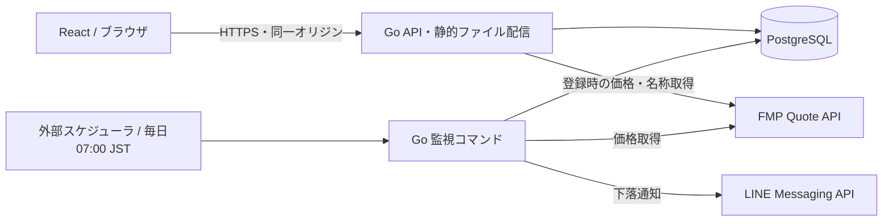

# 株・指数の下落通知サービス

任意の銘柄コードを登録し、監視開始後の最高値からの下落率が設定値に到達したとき、LINEへ通知する自分専用のサービスの仕様書です。

## 仕様書の目次

| 分類 | 文書 | 内容 |
| --- | --- | --- |
| 機能 | [機能仕様](design/features.md) | 登録、一覧、停止・再開、削除、通知設定 |
| 通知 | [通知・日次処理](design/monitoring.md) | 判定式、具体例、処理順序、障害・同時実行 |
| DB | [ER図・テーブル定義](design/database.md) | PostgreSQLの型、キー、制約、状態 |
| 認証・運用 | [認証・運用仕様](design/security-operations.md) | セッション、CSRF、スケジュール、環境変数 |
| API | [API仕様](api/README.md) / [OpenAPI](api/openapi.yaml) | 要求・応答、検索・ソート、共通エラー |
| 画面 | [ログイン](ui/login.md) | ログイン、エラー、画面遷移 |
| 画面 | [監視対象一覧](ui/assets.md) | 追加、検索、ソート、停止・再開、削除 |
| 画面 | [通知設定](ui/settings.md) | 共通通知率の変更・保存 |
| 検証 | [受け入れ条件](design/acceptance.md) / [検証結果](design/verification.md) | 機能・画面・API・障害の確認シナリオと実施結果 |

## システム構成

GoのWebプロセスと監視コマンドは同じDBを利用します。通知先は単一のLINEユーザーです。管理者はアプリ内ログインを利用し、管理者ID・パスワードハッシュと外部APIの秘密情報はサーバー設定で管理します。

対象はFMPの契約で価格を取得できる株・指数です。「最高値」は登録時と毎日07:00（日本時間）の取得時に観測した価格の最大値を指します。過去の最高値や日中の全値動きを示すものではありません。

## 画面イメージの確認

[ログイン](asset/login.html)、[監視対象一覧](asset/assets.html)、[通知設定](asset/settings.html)をブラウザで開けます。サーバー・外部ライブラリ・ネットワーク接続は不要です。

HTML上部の「画面確認用」パネルで読み込み中・空状態・通信失敗などを切り替えられます。ログインは任意の空でないIDとパスワードで一覧へ進み、一覧にはサンプルデータを表示します。追加・検索・ソート・停止・再開・削除と通知率編集を画面内で試せます。各ページを再読み込みするとサンプル状態へ戻ります。実際の認証、DB保存、価格取得、LINE送信は行いません。

## 文書の読み方・対象範囲

- 本文書の入力名・応答名はOpenAPIと一致させます。エンドポイントの型・必須項目はOpenAPIを参照してください。
- 画面のURLはReactアプリのルートです。`asset/`のHTMLパスは画面イメージのファイルパスです。
- 日時はDB・APIでUTC、画面で日本時間。価格と下落率はAPIで十進数文字列として扱います。
- 成果物は仕様書とHTMLの画面イメージです。Go・Reactの製品コードは含みません。
- 過去最高値の取得、銘柄別通知率、複数ユーザー、チャート、価格履歴、パスワード変更画面は対象外です。

## 外部サービス・形式の参照

- [FMP Stock Quote API](https://site.financialmodelingprep.com/developer/docs/stable/quote)：銘柄コードを指定する価格取得エンドポイント。
- [LINE Messaging API](https://developers.line.biz/en/reference/messaging-api/#send-push-message)：プッシュ通知。
- [LINEの再試行仕様](https://developers.line.biz/en/docs/messaging-api/retrying-api-request/)：受付後の通信失敗や再試行で重複が起こり得ること、受付と配信の違い。
- [OWASP CSRF対策](https://cheatsheetseries.owasp.org/cheatsheets/Cross-Site_Request_Forgery_Prevention_Cheat_Sheet.html)：同一オリジン確認とセッションに結び付くトークン。
- [OpenAPI 3.0.3](https://spec.openapis.org/oas/v3.0.3.html)：API記述形式。

仕様策定日：2026-10-08。
