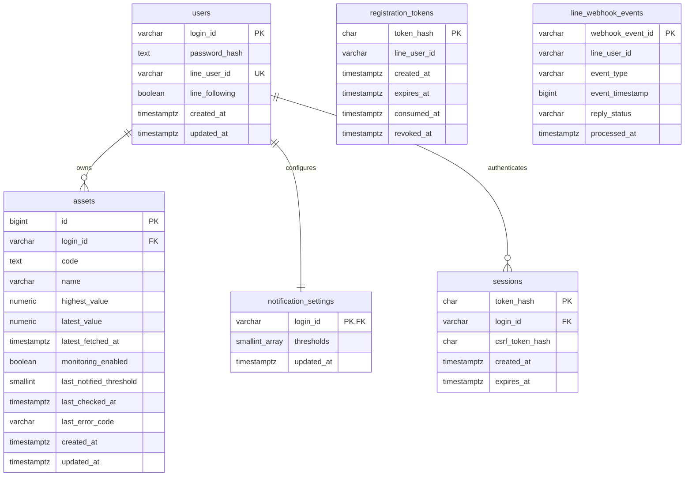

# ER図・テーブル定義

PostgreSQLを使用する。ユーザーの主キーは`login_id`で、別の`user_id`は設けない。監視対象・通知設定・セッションを外部キーでユーザーに紐付ける。LINE通知先は`users.line_user_id`から取得する。登録・Webhookの処理順序は[ユーザー登録・LINE連携](registration.md)を参照。

## users：ユーザー

| 列 | 型 | NULL | 制約・意味 |
| --- | --- | --- | --- |
| login_id | VARCHAR(100) | 不可 | 主キー。1〜100文字、大小文字・前後空白を区別する完全一致。変更しない |
| password_hash | TEXT | 不可 | bcrypt cost 12以上のハッシュ。平文パスワードは保存しない |
| line_user_id | VARCHAR(33) | 不可 | UNIQUE。Webhookの`source.userId`。`U`と32桁の16進数からなるLINEユーザーID |
| line_following | BOOLEAN | 不可 | 登録時true。followでtrue、unfollowでfalse。falseでもログイン・価格監視を許可し、LINE送信のみ抑止 |
| created_at | TIMESTAMPTZ | 不可 | 登録完了日時 |
| updated_at | TIMESTAMPTZ | 不可 | ユーザーレコード更新日時 |

`login_id`はトリミング・大小文字変換・Unicode正規化をせず、非決定的・大小文字同一視の照合を使用しない。DBの主キー比較とAPIの完全一致を揃える。認証で見つからないIDとパスワード不一致は同じエラーにする。パスワードハッシュ・LINEユーザーID・友だち状態はセッション応答に含めない。

## assets：監視対象

| 列 | 型 | NULL | 制約・意味 |
| --- | --- | --- | --- |
| id | BIGINT GENERATED ALWAYS AS IDENTITY | 不可 | 主キー。APIでは十進整数文字列で返す |
| login_id | VARCHAR(100) | 不可 | `users(login_id)`への外部キー。所有者。作成後は変更しない |
| code | TEXT | 不可 | UNIQUE(login_id, code)。正規化済み、1〜64文字、空白・制御文字不可 |
| name | VARCHAR(200) | 不可 | 1〜200文字、空白のみ不可。外部名称またはコード |
| highest_value | NUMERIC | 不可 | 有限かつ正の監視最高値 |
| latest_value | NUMERIC | 不可 | 有限かつ正の最終取得値、`latest_value <= highest_value` |
| latest_fetched_at | TIMESTAMPTZ | 不可 | 保存対象価格の取得完了日時。日次処理は鮮度確認通過時だけ更新。警告付き新規登録では古い価格でも記録 |
| monitoring_enabled | BOOLEAN | 不可 | 日次の価格取得・最高値更新・通知判定を有効にする。既定true。falseの対象は日次処理対象外。停滞通知成功時と古い価格での新規登録時はfalse |
| last_notified_threshold | SMALLINT | 可 | null=未通知、その他は1〜99。設定変更後に設定に含まれない値も保持 |
| last_checked_at | TIMESTAMPTZ | 不可 | 登録または日次処理の価格取得試行の完了日時。失敗でも更新 |
| last_error_code | VARCHAR(32) | 可 | null、`PRICE_FETCH_FAILED`、`NOTIFICATION_FAILED`、`PRICE_DATA_STALE`のいずれか |
| created_at | TIMESTAMPTZ | 不可 | 登録日時、既定CURRENT_TIMESTAMP |
| updated_at | TIMESTAMPTZ | 不可 | レコード更新日時。登録時は作成日時と同値 |

価格の`NUMERIC`は精度・小数桁を固定しない。DB制約は`value > 0 AND value < 'Infinity'::numeric`を使用し、アプリでも有限性を検証する。最高値と最新値の更新は同一トランザクションとする。`updated_at`は価格・通知状態・エラー・有効状態の保存時に更新し、取得日時の代用にはしない。

FMPのtimestamp専用の列は追加しない。日次処理で240時間以上前のデータを検知した場合、価格・最高値・`latest_fetched_at`・通知済み率を保持し、`last_checked_at`とエラーを保存する。停滞通知成功時は同じトランザクションで`monitoring_enabled=false`にし、失敗時は有効状態を維持する。ブロック中は送信せず、監視中のまま`PRICE_DATA_STALE`を保存する。警告付きの新規登録では古い価格を最高値・最終取得値として保存し、停止状態・`PRICE_DATA_STALE`で開始する。手動再開では価格・通知済み率・エラーを変更しない。

`decline_rate`は保存しない。`(highest_value-latest_value)/highest_value×100`から導出し、APIは小数2桁の文字列を返す。閾値判定・ソートは丸め前を使用する。価格をJSの浮動小数点数に変換して通知判定しない。

## notification_settings：ユーザー別の通知設定

| 列 | 型 | NULL | 制約・意味 |
| --- | --- | --- | --- |
| login_id | VARCHAR(100) | 不可 | 主キー、`users(login_id)`への外部キー。ユーザーごとに1行 |
| thresholds | SMALLINT[] | 不可 | 1次元、1〜99件、null要素不可、各要素1〜99、重複不可、昇順 |
| updated_at | TIMESTAMPTZ | 不可 | 設定更新日時 |

ユーザー登録時に同一トランザクションで`thresholds=ARRAY[10,15,20,25,30]`を作成する。DB初期化時の全体設定・初期ユーザーは作成しない。空配列・範囲外・null要素はCHECK制約で拒否し、配列の昇順・重複なしは検証関数を利用したCHECKで保証する。アプリは入力を検証して昇順に正規化する。設定行が欠けている場合、そのユーザーの設定APIは503、監視はそのユーザーを失敗として他ユーザーを継続する。実行中に初期設定へ戻さない。

## sessions：ログインセッション

| 列 | 型 | NULL | 制約・意味 |
| --- | --- | --- | --- |
| token_hash | CHAR(64) | 不可 | 主キー、32バイト以上の乱数トークンのSHA-256を16進表記 |
| login_id | VARCHAR(100) | 不可 | `users(login_id)`への外部キー。セッションの所有者 |
| csrf_token_hash | CHAR(64) | 不可 | セッションに結び付くCSRFトークンのSHA-256を16進表記 |
| created_at | TIMESTAMPTZ | 不可 | 発行日時 |
| expires_at | TIMESTAMPTZ | 不可 | 発行から24時間、CHECK(expires_at > created_at) |

平文のセッショントークンはCookieにだけ返し、DBに保存しない。CSRFトークンはCookieから復元できるためハッシュだけ保存する。認証のたびに`expires_at > 現在時刻`とユーザーの存在を検証する。ログアウトは該当行だけを削除し、他ユーザー・他ブラウザのセッションを失効しない。複数のブラウザの同時ログインは許可する。

## registration_tokens：登録用の一時トークン

| 列 | 型 | NULL | 制約・意味 |
| --- | --- | --- | --- |
| token_hash | CHAR(64) | 不可 | 主キー、32バイト乱数をBase64URL化したトークンのSHA-256（16進数） |
| line_user_id | VARCHAR(33) | 不可 | Webhookから取得した登録先。ユーザー作成前なのでusersへの外部キーは設けない |
| created_at | TIMESTAMPTZ | 不可 | 発行日時 |
| expires_at | TIMESTAMPTZ | 不可 | 発行から24時間、CHECK(expires_at > created_at) |
| consumed_at | TIMESTAMPTZ | 可 | 登録完了時刻。確認APIでは更新しない |
| revoked_at | TIMESTAMPTZ | 可 | 再発行・ブロックでの失効時刻 |

未使用・未失効行に`UNIQUE(line_user_id) WHERE consumed_at IS NULL AND revoked_at IS NULL`の部分ユニークインデックスを設ける。期限切れを含め旧行を失効してから新行を作成する。期限・消費・失効・ユーザー登録有無・最新の友だち状態を確認し、1回の登録でのみ消費できるようトランザクションで保証する。

## line_webhook_events：処理履歴

| 列 | 型 | NULL | 制約・意味 |
| --- | --- | --- | --- |
| webhook_event_id | VARCHAR(128) | 不可 | 主キー。LINEの`webhookEventId` |
| line_user_id | VARCHAR(33) | 不可 | 処理対象のLINEユーザーID。登録前も記録するため外部キーなし |
| event_type | VARCHAR(16) | 不可 | `follow`、`unfollow`、`registration`（テキスト「登録」） |
| event_timestamp | BIGINT | 不可 | LINEイベントのUNIXミリ秒。非負。到着時刻ではない |
| reply_status | VARCHAR(16) | 不可 | `not_required`、`pending`、`sent`、`failed`。重複・古いイベントは返信しない |
| processed_at | TIMESTAMPTZ | 不可 | 業務処理をコミットした時刻 |

重複・古いイベントによる再発行・友だち状態の巻き戻しを防ぐ。`reply_status`がpending/failedでも業務処理を再実行しない。署名不正・無視するイベントは保存しない。順序判定・重複排除に使う履歴は自動削除しない。Webhook本文・replyToken・登録URLの平文は保存しない。

## インデックス・参照整合性

- 主キー・一意制約に加え、`sessions(expires_at)`、`sessions(login_id)`、`registration_tokens(expires_at)`、`line_webhook_events(line_user_id, event_timestamp)`を設ける。銘柄検索は所有者で絞ってから行う。
- usersへの外部キーは`ON UPDATE RESTRICT ON DELETE RESTRICT`。ユーザー削除・ID変更のAPIは設けない。資産IDは全体で一意のままで、他ユーザーのIDを指定しても認可しない。

## 初期化・更新・削除

- デプロイ前のマイグレーションで空の6テーブルと制約を作成する。API・日次処理はDDLを実行しない。旧スキーマ・旧データの移行は提供せず、開発DBの再作成を前提とする。
- DB接続のタイムゾーンをUTCに統一する。APIはRFC 3339、ブラウザは`Asia/Tokyo`で表示する。
- 監視対象の削除は物理削除し、IDは再使用しない。セッション削除は監視対象・設定に影響しない。
- バックアップ対象はDB全体。ユーザーのパスワードハッシュ・LINEユーザーIDを含むためアクセスを制限する。外部APIの秘密情報はDBバックアップに含めない。復元後はセッションを全削除し、未使用登録トークンをすべて失効する。
