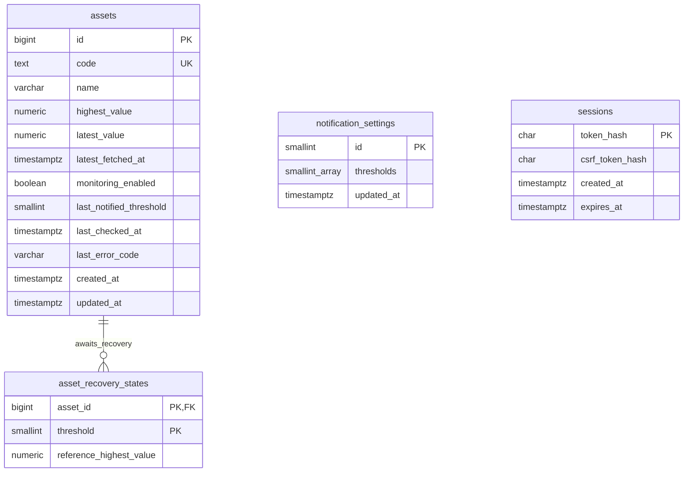

# ER図・テーブル定義

PostgreSQLを使用する。単一管理者のため所有者列・ユーザーテーブルは設けない。監視対象と共通設定は全体に適用され、セッションは管理者の認証に使用する。4テーブルで構成し、回復待ちは監視対象への外部キーを持つ。隣接する複数ユーザー対応実装との差分は[関連実装への影響](implementation-impact.md)を参照。

## assets：監視対象

| 列 | 型 | NULL | 制約・意味 |
| --- | --- | --- | --- |
| id | BIGINT GENERATED ALWAYS AS IDENTITY | 不可 | 主キー。APIでは十進整数文字列で返す |
| code | TEXT | 不可 | ユニーク、正規化済み、1〜64文字、空白・制御文字不可 |
| name | VARCHAR(200) | 不可 | 1〜200文字、空白のみ不可。外部名称またはコード |
| highest_value | NUMERIC | 不可 | 有限かつ正の監視最高値 |
| latest_value | NUMERIC | 不可 | 有限かつ正の最終取得値、`latest_value <= highest_value` |
| latest_fetched_at | TIMESTAMPTZ | 不可 | 保存対象価格の取得完了日時。日次処理は鮮度確認通過時だけ更新。警告付き新規登録では古い価格でも記録 |
| monitoring_enabled | BOOLEAN | 不可 | 日次の価格取得・最高値更新・下落と回復の通知判定を有効にする。既定true。falseの対象は日次処理対象外。停滞通知成功時と古い価格での新規登録時はfalse |
| last_notified_threshold | SMALLINT | 可 | 現在の最高値を基準に最後に成功した下落通知の最大率。1〜99、null=当該最高値で下落通知なし。新高値でnull、回復・設定変更では保持。通知判定に使わない |
| last_checked_at | TIMESTAMPTZ | 不可 | 登録または日次処理の価格取得試行の完了日時。失敗でも更新 |
| last_error_code | VARCHAR(32) | 可 | null、`PRICE_FETCH_FAILED`、`NOTIFICATION_FAILED`、`PRICE_DATA_STALE`のいずれか |
| created_at | TIMESTAMPTZ | 不可 | 登録日時、既定CURRENT_TIMESTAMP |
| updated_at | TIMESTAMPTZ | 不可 | レコード更新日時。登録時は作成日時と同値 |

価格の`NUMERIC`は精度・小数桁を固定しない。DB制約は`value > 0 AND value < 'Infinity'::numeric`を使用し、アプリでも有限性を検証する。最高値と最新値の更新は同一トランザクションとする。`updated_at`は価格・通知状態・エラー・有効状態の保存時に更新し、取得日時の代用にはしない。

FMPのtimestamp専用の列は追加しない。日次処理で240時間以上前のデータを検知した場合、価格・最高値・`latest_fetched_at`・最終下落通知率・回復待ちと基準最高値を保持し、`last_checked_at`とエラーを保存する。停滞通知成功時は同じトランザクションで`monitoring_enabled=false`にし、失敗時は有効状態を維持する。警告付きの新規登録では古い価格を最高値・最終取得値として保存し、停止状態・`PRICE_DATA_STALE`で開始する。手動再開では価格・最終下落通知率・回復待ち・基準最高値・エラーを変更しない。

`decline_rate`は保存しない。`(highest_value-latest_value)/highest_value×100`から導出し、APIは小数2桁の文字列を返す。閾値判定・ソートは丸め前を使用する。価格をJSの浮動小数点数に変換して通知判定しない。

## asset_recovery_states：内部の回復待ち

| 列 | 型 | NULL | 制約・意味 |
| --- | --- | --- | --- |
| asset_id | BIGINT | 不可 | assets(id)への外部キー。ON UPDATE RESTRICT ON DELETE CASCADE |
| threshold | SMALLINT | 不可 | 1〜99。asset_idと複合主キー、銘柄・率ごとに最大1行 |
| reference_highest_value | NUMERIC | 不可 | 下落通知成功時の最高値B。有限かつ正。回復通知まで固定 |

行の存在が回復待ちを表す。登録時は0行とし、下落通知成功時にだけ作成、回復通知成功時に削除する。設定から削除した率と銘柄自体の削除も待ちを取り消す。停止・再開では保持する。回復済み履歴や送信失敗ジョブは保存しない。

reference_highest_valueは価格と同じ精度・有限性の制約を使う。現在のassets.highest_value以下であることをアプリで保証する。新高値の更新・送信失敗・ブロック抑止で書き換えない。旧基準の回復通知が未成功でも、最新の最高値は通常どおり保存できるよう分離する。

価格・最高値・最終下落通知率と待ちの作成削除を同一トランザクションで保存する。設定の置換と削除率の待ち取消も、停止中を含め同一トランザクションで行う。待ちを公開APIに追加せず、通知判定のために内部だけで取得する。複合主キーの先頭がasset_idなので、銘柄単位の取得・連動削除に別インデックスは不要。

## notification_settings：全体の通知設定

| 列 | 型 | NULL | 制約・意味 |
| --- | --- | --- | --- |
| id | SMALLINT | 不可 | 主キー、CHECK(id=1)。単一行 |
| thresholds | SMALLINT[] | 不可 | 1次元、1〜99件、null要素不可、各要素1〜99、重複不可、昇順 |
| updated_at | TIMESTAMPTZ | 不可 | 設定更新日時 |

DB初期化時に`id=1, thresholds=ARRAY[10,15,20,25,30]`を作成する。空配列・範囲外・null要素はCHECK制約で拒否し、配列の昇順・重複なしは検証関数を利用したCHECKで保証する。アプリは入力を検証して昇順に正規化する。設定行が欠けている場合は構成不備としてAPI・監視処理を失敗させ、実行中に初期設定へ戻さない。

## sessions：ログインセッション

| 列 | 型 | NULL | 制約・意味 |
| --- | --- | --- | --- |
| token_hash | CHAR(64) | 不可 | 主キー、32バイト以上の乱数トークンのSHA-256を16進表記 |
| csrf_token_hash | CHAR(64) | 不可 | セッションに結び付くCSRFトークンのSHA-256を16進表記 |
| created_at | TIMESTAMPTZ | 不可 | 発行日時 |
| expires_at | TIMESTAMPTZ | 不可 | 発行から24時間、CHECK(expires_at > created_at) |

平文のセッショントークンはCookieにだけ返し、DBに保存しない。CSRFトークンは後述のCookieから復元できるためハッシュだけ保存する。認証のたびに`expires_at > 現在時刻`を検証する。ログアウトは該当行を削除し、管理者設定変更時は全行を削除する。複数のブラウザの同時ログインは許可する。

`sessions(expires_at)`に期限切れ掃除用のインデックスを設ける。他はコードのユニークインデックスと回復待ちの複合主キーを使用する。検索・ソートは小規模な個人用一覧を前提とする。

## 初期化・更新・削除

- デプロイ前のマイグレーションで4テーブルと制約、共通設定の単一行を作成する。API・日次処理はDDLを実行しない。旧データ移行・last_notified_thresholdからの待ち復元は提供せず、開発DBを再作成する。
- DB接続のタイムゾーンをUTCに統一する。APIはRFC 3339、ブラウザは`Asia/Tokyo`で表示する。
- 監視対象の削除は待ちを連動して物理削除し、IDは再使用しない。セッション削除は監視対象・設定に影響しない。
- バックアップ対象はDB全体。外部APIの秘密情報と管理者設定はDBバックアップに含めない。
