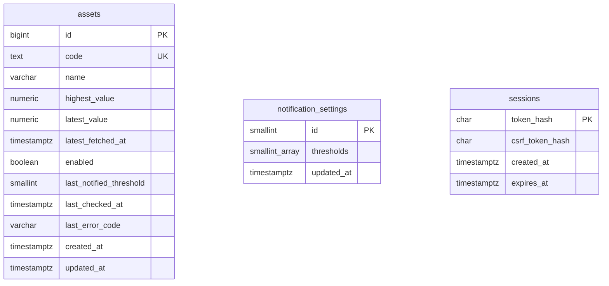

# ER図・テーブル定義

PostgreSQLを使用する。単一管理者のため所有者列・ユーザーテーブルは設けない。監視対象と共通設定は全体に適用され、セッションは管理者の認証に使用する。3テーブルは独立し、外部キーの関係を持たない。

## assets：監視対象

| 列 | 型 | NULL | 制約・意味 |
| --- | --- | --- | --- |
| id | BIGINT GENERATED ALWAYS AS IDENTITY | 不可 | 主キー。APIでは十進整数文字列で返す |
| code | TEXT | 不可 | ユニーク、正規化済み、1〜64文字、空白・制御文字不可 |
| name | VARCHAR(200) | 不可 | 1〜200文字、空白のみ不可。外部名称またはコード |
| highest_value | NUMERIC | 不可 | 有限かつ正の監視最高値 |
| latest_value | NUMERIC | 不可 | 有限かつ正の最終取得値、`latest_value <= highest_value` |
| latest_fetched_at | TIMESTAMPTZ | 不可 | 有効価格の取得完了日時 |
| enabled | BOOLEAN | 不可 | 既定true。falseの対象は日次処理対象外 |
| last_notified_threshold | SMALLINT | 可 | null=未通知、その他は1〜99。設定変更後に設定に含まれない値も保持 |
| last_checked_at | TIMESTAMPTZ | 不可 | 登録または日次処理の価格取得試行の完了日時。失敗でも更新 |
| last_error_code | VARCHAR(32) | 可 | null、`PRICE_FETCH_FAILED`、`NOTIFICATION_FAILED`のいずれか |
| created_at | TIMESTAMPTZ | 不可 | 登録日時、既定CURRENT_TIMESTAMP |
| updated_at | TIMESTAMPTZ | 不可 | レコード更新日時。登録時は作成日時と同値 |

価格の`NUMERIC`は精度・小数桁を固定しない。DB制約は`value > 0 AND value < 'Infinity'::numeric`を使用し、アプリでも有限性を検証する。最高値と最新値の更新は同一トランザクションとする。`updated_at`は価格・通知状態・エラー・有効状態の保存時に更新し、取得日時の代用にはしない。

`decline_rate`は保存しない。`(highest_value-latest_value)/highest_value×100`から導出し、APIは小数2桁の文字列を返す。閾値判定・ソートは丸め前を使用する。価格をJSの浮動小数点数に変換して通知判定しない。

## notification_settings：全体の通知設定

| 列 | 型 | NULL | 制約・意味 |
| --- | --- | --- | --- |
| id | SMALLINT | 不可 | 主キー、CHECK(id=1)。単一行 |
| thresholds | SMALLINT[] | 不可 | 1次元、1〜99件、null要素不可、各要素1〜99、重複不可、昇順 |
| updated_at | TIMESTAMPTZ | 不可 | 設定更新日時 |

DB初期化時に`id=1, thresholds=ARRAY[10,15,20,25,30]`を作成する。空配列・範囲外・null要素はCHECK制約で拒否し、配列の昇順・重複なしは検証関数を利用したCHECKで保証する。アプリは入力を検証して昇順に正規化する。設定行が欠けている場合は構成不備としてAPI・監視処理を失敗させ、実行中に初期設定へ戻さない。

## sessions：ログインセッション

| 列 | 型 | NULL | 制約・意味 |
| --- | --- | --- | --- |
| token_hash | CHAR(64) | 不可 | 主キー、32バイト以上の乱数トークンのSHA-256を16進表記 |
| csrf_token_hash | CHAR(64) | 不可 | セッションに結び付くCSRFトークンのSHA-256を16進表記 |
| created_at | TIMESTAMPTZ | 不可 | 発行日時 |
| expires_at | TIMESTAMPTZ | 不可 | 発行から24時間、CHECK(expires_at > created_at) |

平文のセッショントークンはCookieにだけ返し、DBに保存しない。CSRFトークンは後述のCookieから復元できるためハッシュだけ保存する。認証のたびに`expires_at > 現在時刻`を検証する。ログアウトは該当行を削除し、管理者設定変更時は全行を削除する。複数のブラウザの同時ログインは許可する。

`sessions(expires_at)`に期限切れ掃除用のインデックスを設ける。コードのユニークインデックス以外は初期版で追加しない。検索・ソートは小規模な個人用一覧を前提とする。

## 初期化・更新・削除

- デプロイ前のマイグレーションでテーブルと制約、共通設定の単一行を作成する。API・日次処理はDDLを実行しない。
- DB接続のタイムゾーンをUTCに統一する。APIはRFC 3339、ブラウザは`Asia/Tokyo`で表示する。
- 監視対象の削除は物理削除し、IDは再使用しない。セッション削除は監視対象・設定に影響しない。
- バックアップ対象はDB全体。外部APIの秘密情報と管理者設定はDBバックアップに含めない。
