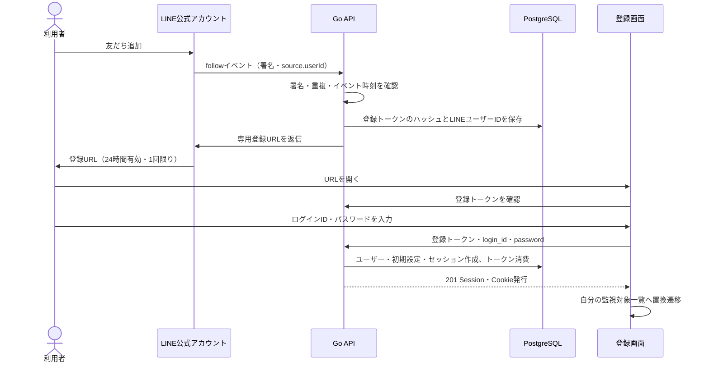

# ユーザー登録・LINE連携仕様

## 識別子・登録フロー

アプリのユーザー識別子は`login_id`。別の`user_id`は設けない。1つのLINEユーザーIDで登録できるアプリユーザーは1人とし、通知先は`users.line_user_id`に保持する。LINE Login・LIFFは使用せず、LINEトークに届く専用URLの所持を登録権限とする。URLを共有しないよう案内する。

ユーザー作成時点では銘柄は0件。通知率は`[10,15,20,25,30]`。ログインIDは1〜100文字のUTF-8文字列で、大小文字・前後空白を含め完全一致とし、正規化しない。パスワードはUTF-8で8〜72バイト、空白を除去せず、bcrypt cost 12以上でハッシュ化する。ログインID・パスワード変更、退会、既存ユーザーと別のLINEの再連携は対象外。

## Webhookの受信・イベント処理

受信先は`POST /api/v1/webhooks/line`。`X-Line-Signature`と未加工の本文から、`LINE_CHANNEL_SECRET`を鍵にHMAC-SHA256・Base64で署名を検証する。JSONの再シリアライズ後に検証しない。Cookie・Origin・CSRFトークンは要求しない。署名の欠落・不一致は`403 INVALID_LINE_SIGNATURE`、JSON・必須構造の不正は400、DB利用不可は503とし、イベントの業務処理を行わない。

1リクエストの`events`は全件の必須構造を先に検証してから順に処理する。署名付きの`events=[]`は検証リクエストとして200・本文なし。対象は`source.type=user`かつ`source.userId`が得られる1対1トークのみ。グループ・ルーム、userIdなし、未対応イベントは200で無視する。LINEが追加する未知のプロパティは許可する。

| イベント・状態 | 処理・返信 |
| --- | --- |
| `follow`、未登録 | 有効な旧URLを失効し、新しい登録URLを返信。ブロック解除によるfollowも同じ |
| `follow`、登録済み | `users.line_following=true`にし、`PUBLIC_ORIGIN/login`を返信。新規ユーザー・登録URLは作成しない |
| `message`のテキストが前後空白除去後に「登録」、未登録 | 直近の友だち状態がブロックなら発行しない。それ以外は旧URLを失効し、新URLを返信。既に友だちの利用者もこの操作から開始できる |
| 同じ「登録」メッセージ、登録済み | ログインURLを返信。友だち状態は変更しない |
| `unfollow` | 登録済みは`line_following=false`、登録前は未使用URLをすべて失効。返信しない。銘柄・設定・セッションは削除しない |
| その他のメッセージ・イベント | 登録や通知設定を変更せず、返信しない |

`follow`は友だち追加・ブロック解除の両方で発生する。`follow.isUnblocked`によらずDBの登録有無で分岐する。[LINEのfollow仕様](https://developers.line.biz/en/reference/messaging-api/#follow-event)を参照。

### 重複・順序逆転・送信失敗

- `webhookEventId`をDBの主キーとして重複を検出する。既に業務処理をコミットしたイベントは200でスキップし、再発行・再登録・再返信しない。`deliveryContext.isRedelivery`だけで判断しない。
- 登録・再発行・ブロック更新はLINEユーザーID単位の短いDBトランザクションで直列化する。これは登録整合性のための制御であり、日次監視との排他制御は追加しない。
- `timestamp`（UNIXミリ秒）を使用する。友だち状態は同じLINEの最新follow/unfollowと比較し、古い状態更新を省く。URL発行・返信は最新の処理済み対象イベントと比較し、古い要求なら省く。同時刻では`unfollow`を優先し、その他は先に処理したイベントを優先する。履歴は残す。これにより新しいメッセージの後に届いたfollowであっても、最新の友だち状態は反映でき、古いURLを再発行しない。登録済みの友だち状態を変更するのはfollow/unfollowのみ。
- DBでイベント処理とトークン発行・失効／友だち状態更新をコミットした後、`replyToken`を用いてLINE Reply APIを1回呼ぶ。外部通信は最大30秒。登録URLの平文トークン・replyTokenはリクエスト処理中のメモリだけに置く。
- 返信のHTTP 200を受付成功として履歴に保存する。返信失敗・成否不明でも発行済みURLを巻き戻さずWebhookには200を返す。DBコミット前の失敗は503で再配信を受け付ける。複数イベントの途中失敗時も、コミット済みイベントは再配信時にスキップする。
- DBコミット後・返信前の停止や応答消失でURLが届かないことを許容し、永続的な返信キューは設けない。返信状態`pending`の残存・`failed`を運用で検知し、利用者は「登録」の再送で復旧する。返信後の履歴保存失敗では同じイベントの返信を繰り返さない。LINE公式アカウントの案内にも「URLが届かない／期限切れの場合は『登録』と送信」を記載する。

[Webhookの重複・再配信・順序](https://developers.line.biz/en/docs/messaging-api/receiving-messages/)、[署名検証](https://developers.line.biz/en/docs/messaging-api/verify-webhook-signature/)、[Reply API](https://developers.line.biz/en/reference/messaging-api/#send-reply-message)を参照。Webhook処理履歴は重複判定・順序判定に使用するため初期版では自動削除しない。本文全体・返信トークンは保存しない。

「登録」による再発行はLINEユーザーID別に15分・5回までとし、超過時は旧URLを失効せず待機を返信する。[認証・運用仕様](security-operations.md)の試行制限と合わせて実装する。

## 専用登録URL・登録API

URLは`PUBLIC_ORIGIN/register#token=<token>`。トークンは暗号学的乱数32バイトのBase64URL（パディングなし、43文字）とし、SHA-256ハッシュだけをDBに保存する。有効条件は`expires_at > 現在時刻`かつ未使用・未失効・LINEユーザー未登録・ブロックされていないこと。発行から24時間ちょうどで無効とする。再発行は旧URLの失効と新規発行を同一トランザクションにする。

- `POST /api/v1/auth/registration/validate`：`registration_token`を本文で受け、有効なら200で`expires_at`だけを返す。確認だけでは消費しない。
- `POST /api/v1/auth/register`：`registration_token`・`login_id`・`password`を受ける。登録成功は201でSessionと24時間の認証・CSRF Cookieを返す。LINEユーザーIDをクライアントから受け付けない。
- 登録完了時も有効性を再検証する。トークン消費、ユーザーと通知設定の作成、セッション発行を原子的に行い、失敗時はすべてロールバックする。DBの一意制約でログインID・LINEの二重登録を拒否する。
- ID重複は`409 LOGIN_ID_ALREADY_EXISTS`。入力と有効なトークンを保持して別のIDで再送できる。無効・不明・期限切れ・使用済み・失効済みURLは共通の`410 REGISTRATION_LINK_UNAVAILABLE`で、登録・パスワード更新・セッション発行を行わない。
- 現在のブラウザがログイン済みでも登録画面を表示する。登録成功時は現在のCookieに対応する旧セッションを失効し、新ユーザーのセッションへ置換する。他のブラウザのセッションは維持する。
- 登録の成否が通信断などで不明な場合は自動再送しない。まず`GET /auth/session`で入力した`login_id`のセッションか確認し、確認できなければ入力したID・パスワードでログインするよう案内する。失敗を確定できるまで成功と表示しない。

URLのフラグメントはAPIクエリ・アクセスログへ送らない。画面はトークンをメモリで扱い、成功・離脱時に破棄し、成功時にURLからも消す。登録画面は`Referrer-Policy: no-referrer`・`Cache-Control: no-store`、外部解析タグなし。ログイン・登録・有効性確認にはOrigin・JSON検証を適用し、認証CookieやCSRFトークンは必須にしない。[画面仕様](../ui/register.md)、[API仕様](../api/README.md)、[DB仕様](database.md)も参照。
